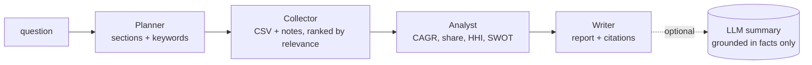

# MarketCrew - agentic market research, with receipts

Give it a research question and it runs a **four-agent pipeline** that produces a market report where
**every number is computed from data and every claim carries a source id**.



| Agent | Does | Deterministic? |
| --- | --- | --- |
| Planner | Splits the question into report sections and search keywords | yes |
| Collector | Loads `data/market.csv` and `data/notes/*.md`, ranks snippets by keyword relevance | yes |
| Analyst | Market CAGR, per-company share and growth, HHI concentration, leader / fastest / laggard, SWOT bullets each tagged `[S#]` | yes |
| Writer | Renders Markdown with tables and a source list. With an LLM key, the executive summary is written by the model but is **only given computed facts** and told not to add numbers | summary optional |

The key design choice: **the LLM never does arithmetic or invents evidence.** Analysis is plain Python, so the report
is reproducible, testable and auditable. See [`docs/sample_report.md`](docs/sample_report.md) for real output.

## Run
```bash
python -m marketcrew "Which fast charging players grow fastest?" -o report.md
python -m marketcrew --data ./my_data      # your own market.csv + notes/*.md
python -m unittest discover -s tests -t . -v
```
`market.csv` columns: `company, year, revenue_musd, segment`. Bundled data is **synthetic** (clearly not real companies).
Set `ANTHROPIC_API_KEY` / `OPENAI_API_KEY` for LLM-written summaries.

## Extending
* Replace the Collector with a web/API fetcher (keep returning `Evidence`).
* Add an agent between Analyst and Writer (pricing, TAM/SAM/SOM) - hand-offs are plain dataclasses.
